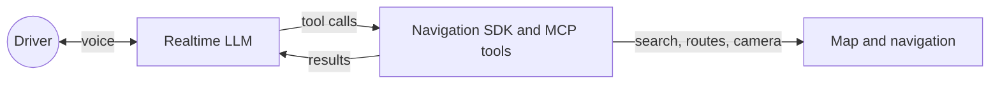

# Mapbox AI Voice Navigation Sample App

> [!NOTE]
> The Mapbox AI Voice Navigation Sample App is available in Public Preview. By using it, you accept the [Mapbox Terms of Service](https://www.mapbox.com/legal/tos/). See [LICENSE.md](LICENSE.md) for details.

> [!WARNING]
> This product is **experimental**. The APIs in the underlying libraries are subject to change, including breaking changes between releases.

Developers are building AI assistants that work directly inside their apps, but these agents usually don't understand the physical world around them. The Mapbox AI Voice Navigation Sample App closes that gap by demonstrating how to add location capabilities to your in-app agents.

The sample app in this repository shows how an agent can read and change context across mapping, search, and navigation controls. For example, a driver can use a voice command during navigation to add a stop to the route or check how traffic will affect an upcoming meeting, and a chat agent can add points to a map, move the map view, or summarize a route. Because the provided SDK handles the agent integration, your team spends less effort on it and can ship sooner.

This repository is a reference example app that shows how to integrate the Mapbox AI Voice Navigation Sample SDK into your own app.

## Get access

The sample apps depend on the Mapbox AI Voice Navigation SDKs, which are available to Public Preview participants. To build the samples from source:

1. [Request access](https://www.mapbox.com/forms/mapbox-agent-toolkit-for-maps-and-navigation-sdk), using the email address of your Mapbox account.
2. We'll let you know when SDK downloads are enabled on your account.
3. Follow your platform's README below to set up your credentials and run the app.

Want to try it first? [Install the pre-built Android APK](#install-the-pre-built-android-apk-github-releases), which you can use right away.

## Platforms

| Platform | Folder                 | Getting started                     |
|----------|------------------------|-------------------------------------|
| Android  | [`android/`](android/) | [Android README](android/README.md) |
| iOS      | [`ios/`](ios/)         | [iOS README](ios/README.md)         |

Each platform's README covers requirements, credentials, and how to run the sample app.

## Install the pre-built Android APK (GitHub Releases)

1. Open [GitHub Releases](https://github.com/mapbox/mapbox-navigation-agent-sample/releases) and download the latest `app-release.apk` from an `android-v*` tag.
2. On your Android device, allow installation from your browser or file manager when prompted.
3. Open **Settings** in the app and paste your [Mapbox public access token](https://account.mapbox.com/access-tokens/) and an OpenAI [project API key](https://platform.openai.com/api-keys) for [GPT-Live](https://developers.openai.com/api/docs/guides/live). The key has to be on a paid usage tier. GPT-Live is unavailable on the free tier, and voice time is billed to that account.
4. Accept the first-launch notices, grant microphone and location when asked, and tap **Start**.

Maps and routing use the Mapbox token you enter in Settings.

## How it works

Each sample app pairs a Mapbox map that has turn-by-turn navigation with a voice assistant. The user talks to a realtime LLM, and the model fulfills the user's voice commands with a combination of two kinds of tools:

- **Navigation SDK tools** run inside the app. They act on the map and the navigation session: they search, plan and change routes, report on the trip, and move the camera.
- **MCP tools** run on the [Mapbox MCP server](https://docs.mapbox.com/location-ai/mcp-servers/mcp-server/). They provide services like search, place details, directions, travel times, areas you can reach, and feedback.

The two samples show different balances of these. The Android sample relies mostly on Navigation SDK tools, and takes only the feedback tool from the MCP server. The iOS sample relies on the MCP server's tools, and the app draws their results on the map: pins, routes, and shapes. It runs a few tools of its own for the session. Both approaches work, so choose the one that fits your app. Each platform's README describes its sample.

When the model calls a tool, the tool runs in the app or on the MCP server, the app updates the map, and the result goes back to the model.

The samples use OpenAI's GPT-Live, but the tools aren't tied to a specific model provider. You can use them with any LLM or AI agent framework.

The Android sample accepts the OpenAI key in the app, on the Settings screen. The iOS sample has no Settings field for it. Put the key in `~/.openai` before you build, as the [iOS README](ios/README.md#openai-key) describes.

## Tools

The SDK gives your agent the following tools, and your app decides which ones to use for its use case. The Platforms column shows which sample offers each one.

The samples also offer tools from the Mapbox MCP server: the iOS sample offers all of them, and the Android sample offers `category_list_tool` and `feedback_tool`. For those tools, see the [Mapbox MCP server documentation](https://docs.mapbox.com/location-ai/mcp-servers/mcp-server/).

| Category     | Tool                              | Platforms    | Description                                                                           |
|--------------|-----------------------------------|--------------|---------------------------------------------------------------------------------------|
| Search       | `nav_sdk_search_places`           | Android      | Searches for places by name, city, neighborhood, or address and pins them on the map. |
| Search       | `nav_sdk_search_category`         | Android      | Searches for nearby places in a category, such as gas stations or coffee shops.       |
| Search       | `nav_sdk_search_along_route`      | Android      | Searches for a place or category along the active route.                              |
| Search       | `place_details_batch_tool`        | Android      | Gets phone numbers, websites, opening hours, and photos for up to 100 places at once. |
| Search       | `nav_sdk_get_search_results`      | Android      | Returns the search results currently shown on the map.                                |
| Search       | `nav_sdk_focus_search_result`     | Android      | Selects one search result on the map and opens its place card.                        |
| Routing      | `nav_sdk_set_destination`         | Android      | Plans a route to a destination and shows a preview without starting navigation.       |
| Routing      | `nav_sdk_navigate_to`             | Android      | Plans a route to a destination and starts turn-by-turn navigation right away.         |
| Routing      | `nav_sdk_start_navigation`        | Android      | Starts turn-by-turn navigation to the current destination.                            |
| Routing      | `nav_sdk_stop_navigation`         | Android      | Stops navigation and returns to free drive.                                           |
| Routing      | `stop_navigation`                 | iOS          | Stops turn-by-turn navigation and keeps the voice session open.                       |
| Routing      | `nav_sdk_dismiss_preview`         | Android      | Dismisses a route preview before navigation starts.                                   |
| Routing      | `nav_sdk_add_waypoint`            | Android      | Adds one or more stops to the current route.                                          |
| Routing      | `nav_sdk_remove_waypoint`         | Android      | Removes one or more stops from the current route.                                     |
| Trip info    | `nav_sdk_get_route_summary`       | Android      | Summarizes the active route's distance, time, and roads ahead.                        |
| Trip info    | `nav_sdk_get_next_maneuver`       | Android      | Describes the next maneuver, including the road name and distance to it.              |
| Trip info    | `nav_sdk_get_traffic_ahead`       | Android      | Summarizes traffic conditions on the rest of the route.                               |
| Trip info    | `nav_sdk_get_user_location`       | Android      | Returns the user's current location.                                                  |
| Map          | `nav_sdk_add_map_markers`         | Android      | Adds pins to the map, with icons that match each place's category.                    |
| Map          | `nav_sdk_clear_map_markers`       | Android      | Removes some or all of the pins on the map.                                           |
| Map          | `nav_sdk_zoom_in`                 | Android      | Zooms the map in by one step.                                                         |
| Map          | `nav_sdk_zoom_out`                | Android      | Zooms the map out by one step.                                                        |
| Map          | `nav_sdk_recenter_camera`         | Android      | Recenters the map on the user's location.                                             |
| Map          | `nav_sdk_route_overview_camera`   | Android      | Shows the whole route on the map.                                                     |
| Map          | `nav_sdk_show_destination`        | Android      | Shows only the destination on the map.                                                |
| Map          | `nav_sdk_show_route_alternatives` | Android      | Shows the route and its alternatives on the map so the user can compare them.         |
| Saved places | `get_home_address`                | Android      | Returns the user's saved home address.                                                |
| Saved places | `set_home_address`                | Android      | Saves the user's home address.                                                        |
| Saved places | `get_work_address`                | Android      | Returns the user's saved work address.                                                |
| Saved places | `set_work_address`                | Android      | Saves the user's work address.                                                        |
| Session      | `end_conversation`                | Android, iOS | Ends the voice session when the user is done.                                         |
