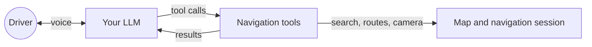

# Voice assistant tools for the Mapbox Navigation SDK

> [!WARNING]
> **Experimental.** Tool names, arguments and APIs may change, including breaking changes between releases. We recommend pinning to a release tag. By using this repository you accept the [Mapbox Terms of Service](https://www.mapbox.com/legal/tos/). See [LICENSE.md](LICENSE.md).

This repository has 30 tools that let a large language model act on a live Mapbox navigation session. With them, a driver can say "find coffee along my route," "add a stop at the airport," or "how's traffic ahead?" The model calls the tools, and they search, plan and change routes, report on the trip, and move the map.

It also has sample apps for Android and iOS that show the tools working with a voice assistant. The samples use OpenAI's GPT-Live. The tools work with any LLM or agent framework.

## Pick your path

| You are | Start here | Time |
|---|---|---|
| Curious, want to see it | [Install the Android APK](#try-it-in-five-minutes) | 5 min |
| Ready to build it yourself | [Run a sample app](#run-a-sample-app) | 30 min |
| Already building on the Navigation SDK | [Add the tools to your app](#add-the-tools-to-your-app) | 1 to 2 hours |

All you need is a Mapbox account. Add an OpenAI API key to try the APK, or use any LLM you like when you build it yourself.

## Try it in five minutes

1. Download the latest `app-release.apk` from an `android-v*` tag on [GitHub Releases](https://github.com/mapbox/mapbox-navigation-agent-tools/releases).
2. On your Android device, allow installs from your browser or file manager.
3. Open **Settings** in the app. Paste your [Mapbox public access token](https://account.mapbox.com/access-tokens/) and an OpenAI [project API key](https://platform.openai.com/api-keys).
4. Grant microphone and location access, then tap **Start** and talk.

## Run a sample app

| Platform | Folder | Guide |
|---|---|---|
| Android | [`android/`](android/) | [Android README](android/README.md) |
| iOS | [`ios/`](ios/) | [iOS README](ios/README.md) |

Each guide covers requirements, Mapbox and OpenAI credentials, and how to run the app. If you're new to the Navigation SDK, its [Android](https://docs.mapbox.com/android/navigation/) and [iOS](https://docs.mapbox.com/ios/navigation/) docs explain the tokens the samples ask for.

## Add the tools to your app

You need an app that already runs a Navigation SDK session, and an LLM connection your app controls.

**Android**

1. Copy `android/toolkit` into your project and add `include(":toolkit")` to `settings.gradle.kts`. Copy the version catalog entries it uses from [`libs.versions.toml`](android/gradle/libs.versions.toml).
2. Add the Mapbox releases and snapshots Maven repositories with your `MAPBOX_DOWNLOADS_TOKEN`, as the sample's [`settings.gradle.kts`](android/settings.gradle.kts) does. The toolkit's `agent` dependency is only in the snapshots repository.
3. Add `implementation(project(":toolkit"))` to your app module.
4. Attach the tools to your navigation view and connect them to your model session. The [Android README](android/README.md#add-the-sdk-to-your-app) has the code.

**iOS**

Add the `MapboxNavigationAgent` Swift package from [`ios/MapboxNavigationAgent`](ios/MapboxNavigationAgent). The [iOS README](ios/README.md) covers credentials and the voice session.

Then copy the Example's `Live` folder, `MapboxMcpClient` and `MapboxVoiceSession` into your app and start a session with your Mapbox token and OpenAI key, as `MainViewModel` does.

**Add your own tools.** Pass them alongside the built-in ones. The Android sample's `DeviceTimeAction` is a complete example.

We expect to change how you add the tools. Watch [Releases](https://github.com/mapbox/mapbox-navigation-agent-tools/releases) for updates.

## How it works

The driver talks to the model. The model calls a tool. The tool acts on the map and the navigation session in your app, and the result goes back to the model.

Most tools run inside your app, on the Navigation SDK. A few come from the [Mapbox MCP server](https://docs.mapbox.com/location-ai/mcp-servers/mcp-server/), such as search categories and driver feedback.

On iOS, every tool comes from the MCP server except `end_conversation`, which the app's `LiveDirector` runs itself.

## What it costs

- **Mapbox:** maps, search and routing count against the Mapbox account that owns your access token, at your normal rates.
- **Model:** you bring the model and pay its provider. The samples use GPT-Live, which needs a paid OpenAI tier. Voice time is billed to your OpenAI account.

## Tools

Your app decides which tools to offer the model. The Platforms column shows which sample offers each one.

The samples also offer tools from the Mapbox MCP server: the iOS sample offers all of them, and the Android sample offers `category_list_tool` and `feedback_tool`. For those tools, see the [Mapbox MCP server documentation](https://docs.mapbox.com/location-ai/mcp-servers/mcp-server/).

| Category     | Tool                              | Platforms    | Description                                                                           |
|--------------|-----------------------------------|--------------|---------------------------------------------------------------------------------------|
| Search       | `nav_sdk_search_places`           | Android      | Searches for places by name, city, neighborhood, or address and pins them on the map. |
| Search       | `nav_sdk_search_category`         | Android      | Searches for nearby places in a category, such as gas stations or coffee shops.       |
| Search       | `nav_sdk_search_along_route`      | Android      | Searches for a place or category along the active route.                              |
| Search       | `place_details_batch_tool`        | Android      | Gets phone numbers, websites, opening hours, and photos for up to 100 places at once. |
| Search       | `nav_sdk_get_search_results`      | Android      | Returns the search results currently shown on the map.                                |
| Search       | `nav_sdk_focus_search_result`     | Android      | Selects one search result on the map and opens its place card.                        |
| Routing      | `nav_sdk_set_destination`         | Android      | Plans a route to a destination and shows a preview without starting navigation.       |
| Routing      | `nav_sdk_navigate_to`             | Android      | Plans a route to a destination and starts turn-by-turn navigation right away.         |
| Routing      | `nav_sdk_start_navigation`        | Android      | Starts turn-by-turn navigation to the current destination.                            |
| Routing      | `nav_sdk_stop_navigation`         | Android      | Stops navigation and returns to free drive.                                           |
| Routing      | `nav_sdk_dismiss_preview`         | Android      | Dismisses a route preview before navigation starts.                                   |
| Routing      | `nav_sdk_add_waypoint`            | Android      | Adds one or more stops to the current route.                                          |
| Routing      | `nav_sdk_remove_waypoint`         | Android      | Removes one or more stops from the current route.                                     |
| Trip info    | `nav_sdk_get_route_summary`       | Android      | Summarizes the active route's distance, time, and roads ahead.                        |
| Trip info    | `nav_sdk_get_next_maneuver`       | Android      | Describes the next maneuver, including the road name and distance to it.              |
| Trip info    | `nav_sdk_get_traffic_ahead`       | Android      | Summarizes traffic conditions on the rest of the route.                               |
| Trip info    | `nav_sdk_get_user_location`       | Android      | Returns the user's current location.                                                  |
| Map          | `nav_sdk_add_map_markers`         | Android      | Adds pins to the map, with icons that match each place's category.                    |
| Map          | `nav_sdk_clear_map_markers`       | Android      | Removes some or all of the pins on the map.                                           |
| Map          | `nav_sdk_zoom_in`                 | Android      | Zooms the map in by one step.                                                         |
| Map          | `nav_sdk_zoom_out`                | Android      | Zooms the map out by one step.                                                        |
| Map          | `nav_sdk_recenter_camera`         | Android      | Recenters the map on the user's location.                                             |
| Map          | `nav_sdk_route_overview_camera`   | Android      | Shows the whole route on the map.                                                     |
| Map          | `nav_sdk_show_destination`        | Android      | Shows only the destination on the map.                                                |
| Map          | `nav_sdk_show_route_alternatives` | Android      | Shows the route and its alternatives on the map so the user can compare them.         |
| Saved places | `get_home_address`                | Android      | Returns the user's saved home address.                                                |
| Saved places | `set_home_address`                | Android      | Saves the user's home address.                                                        |
| Saved places | `get_work_address`                | Android      | Returns the user's saved work address.                                                |
| Saved places | `set_work_address`                | Android      | Saves the user's work address.                                                        |
| Session      | `end_conversation`                | Android, iOS | Ends the voice session when the user is done.                                         |

## Feedback

Open a [GitHub issue](https://github.com/mapbox/mapbox-navigation-agent-tools/issues) for bugs or tool requests. Driver feedback sent through `feedback_tool` goes to Feedback Explorer on your Mapbox account.
