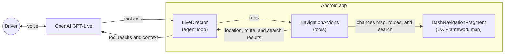

# Mapbox AI Voice Navigation Sample App for Android

This folder is the Android project for the Mapbox AI Voice Navigation Sample App. It has two modules:

- **`toolkit`** is the Mapbox AI Voice Navigation Sample SDK, the library you add to your app. It contains the tools and the code that connects them to an agent.
- **`app`** is the sample app. It shows how to use the SDK with the Navigation SDK UX Framework and OpenAI's GPT-Live.

## Install a pre-built APK

See the [repository README](../README.md#install-the-pre-built-android-apk-github-releases). Release builds collect your Mapbox and OpenAI credentials in the in-app **Settings** screen instead of baking them into the APK.

Tagged release APKs are built by the `release-android-sample` workflow when you push a tag such as `android-v1.0.0`. Configure the GitHub secrets that the workflow's **Verify signing secrets** step checks.

## Getting Started

### Requirements

- Android Studio and JDK 17.
- An Android device or emulator with Android 9 (API 28) or later, and a microphone. The sample app needs API 28 for its WebRTC connection. The `toolkit` library itself supports API 24 and later.

### Credentials

Before you build the app, add the following credentials.

| Credential                 | Required | Used for                                                                    |
|----------------------------|----------|-----------------------------------------------------------------------------|
| `MAPBOX_DOWNLOADS_TOKEN`   | Yes      | Downloading the Mapbox SDKs from the Mapbox Maven repository at build time. |
| `MAPBOX_ACCESS_TOKEN`      | Yes      | Mapbox APIs at runtime (debug builds; release sideloads enter it in Settings). |
| `OPENAI_API_KEY`           | Yes      | GPT-Live sessions (debug builds; release sideloads enter it in Settings).       |

### Mapbox credentials

To create the two Mapbox tokens, follow [Configure credentials](https://docs.mapbox.com/android/navigation/ux/guides/install/#configure-credentials) in the Navigation SDK UX Framework installation guide. Then add `MAPBOX_ACCESS_TOKEN` to `local.properties` in this folder, and add `MAPBOX_DOWNLOADS_TOKEN` to `~/.gradle/gradle.properties`, an environment variable, or `local.properties`.

The assistant's feedback tool also needs the `user-feedback:write` scope on `MAPBOX_ACCESS_TOKEN`. Without it, sending feedback fails with a 403 error. To add the scope, edit your token, or create a new one, on the [Access tokens](https://account.mapbox.com/access-tokens/) page. A token set in `local.properties` takes priority over one entered in Settings, so after changing it there, rebuild the app.

### OpenAI API key

The sample app's voice assistant uses OpenAI's [GPT-Live](https://developers.openai.com/api/docs/guides/live). Create a [project API key](https://platform.openai.com/api-keys) on a paid usage tier. GPT-Live is unavailable on the free tier, and voice time is billed to that account. Add the key to `local.properties` for a debug build, or enter it in the app's **Settings** screen. A release build has no key until you enter it there.

OpenAI is only the demo's choice. The SDK isn't tied to a specific model provider, so you can use its actions with any LLM or AI agent framework.

> [!WARNING]
> The app embeds the OpenAI API key in **debug builds** only. Release APKs leave the key empty at build time; users paste it in Settings. Don't ship an OpenAI API key in a production app. Anyone who has the app can extract it.

### Example `local.properties`

Copy [`local.properties.example`](local.properties.example) if you need a template. Android Studio creates `local.properties` with your Android SDK location when you open the project. Add your credentials below it:

```properties
sdk.dir=/path/to/your/Android/sdk

MAPBOX_ACCESS_TOKEN=pk.your_public_token
OPENAI_API_KEY=sk-your_openai_key

# Only if you don't set it in ~/.gradle/gradle.properties or as an environment variable.
MAPBOX_DOWNLOADS_TOKEN=sk.your_secret_token
```

`local.properties` is listed in `.gitignore`. Don't commit it, because it contains your credentials.

### Run the app

1. Open this folder in Android Studio and run the `app` configuration on your device.
2. Allow microphone and location access when the app asks.
3. Tap **Start**. When the button shows **Listening**, talk to the assistant, for example "Find a coffee shop nearby."
4. Tap the button again to end the session, or say you're done.

Each time the assistant calls a tool, the app shows its name at the top of the screen, so you can see which tool a reply is based on.

### Try it away from the road

To test without driving, open the UX Framework's settings in the app and turn on location simulation.

## Tools

The SDK's tools are listed in the [main README](../README.md#tools). On Android, `NavigationActions.actions` provides them, and `LiveDirector` always adds `end_conversation`.

The sample app also adds three tools of its own. See [Add your own tools](#add-your-own-tools).

- `device_time` reads the device's local date and time.
- `category_list_tool` lists every canonical Mapbox search category ID. `nav_sdk_search_category` names only common categories and tells the assistant to call this tool for any other one, so it doesn't invent a category. [`MapboxCategoryListAction`](app/src/main/java/com/mapbox/toolkit/example/tools/MapboxCategoryListAction.kt) keeps the list for the session.
- `feedback_tool` sends feedback the user gives, such as a closed place or a wrong arrival time, to the Mapbox account that owns your access token, where you review it in Feedback Explorer. [`MapboxFeedbackAction`](app/src/main/java/com/mapbox/toolkit/example/tools/MapboxFeedbackAction.kt) uses your Mapbox access token, which needs the `user-feedback:write` scope (see [Mapbox credentials](#mapbox-credentials)). Each call files a real feedback item.

`category_list_tool` and `feedback_tool` come from the [Mapbox MCP server](https://docs.mapbox.com/location-ai/mcp-servers/mcp-server/), but the app offers only these two of its tools, rather than all of them. The assistant sees each one as a regular app tool, and the action calls the server through [`MapboxMcpClient`](app/src/main/java/com/mapbox/toolkit/example/tools/MapboxMcpClient.kt) with your Mapbox access token.

## How it fits together



The main pieces are:

- **UX Framework map:** your app shows the Navigation SDK UX Framework's `DashNavigationFragment`, which provides the map, routing, and turn-by-turn guidance.
- **`NavigationActions`:** create one per app. It creates the SDK's tools, and keeps track of the state they share, such as the user's location, the active route, and the search results on the map. Call `attach()` with the `DashNavigationFragment` so the tools act on its map. The SDK also draws their results on it: search pins, the destination pin, and route previews.
- **`LiveDirector`:** the agent loop for a GPT-Live session. Create it with `NavigationActions.liveDirector()`, passing the tools the agent can use. It advertises them to the model, runs the tool calls the model makes, and returns the results. It also sends the model context updates whenever the shared state changes, so the model knows where the user is and what's on the map without calling a tool.
- **Live session client:** the sample app's own code (`LiveSessionClient`) opens the connection to OpenAI, streams audio, and passes every server event to `LiveDirector`. The SDK leaves the connection to your app.

For example, when a driver asks for a coffee shop nearby:

1. GPT-Live hears the request and hands it to its backend model, which calls `nav_sdk_search_category`.
2. `LiveDirector` runs the tool, which searches near the user and pins the results on the map.
3. `LiveDirector` returns the results to the model, which reads the best options back to the driver.
4. When the driver picks one, the model calls `nav_sdk_navigate_to`, and turn-by-turn guidance starts on the map.

## Add the SDK to your app

Your app needs the Mapbox Navigation SDK, because the tools act on its map. The `toolkit` SDK isn't published as a Maven artifact yet. To use it in your own app:

1. Copy the `toolkit` folder into your project, and add it in `settings.gradle.kts` with `include(":toolkit")`. Its build file reads library versions from a version catalog, so also copy the entries it uses from [`libs.versions.toml`](gradle/libs.versions.toml).
2. Add the Mapbox releases and snapshots Maven repositories with your `MAPBOX_DOWNLOADS_TOKEN`, as the sample's [`settings.gradle.kts`](settings.gradle.kts) does. The toolkit's `agent` dependency is only in the snapshots repository.
3. Add `implementation(project(":toolkit"))` to your app module's dependencies.

Then connect it to your map and your live session. The sample app does this in `ToolkitApplication`, `MainScreen`, and `MainViewModel`:

```kotlin
// Once per app.
val navigationActions = NavigationActions(applicationContext)

// While your DashNavigationFragment is on screen, so the tools act on its map.
lifecycleScope.launch { navigationActions.attach(navigationFragment) }

// The tools the assistant can use.
val director = navigationActions.liveDirector(navigationActions.actions)

// For each GPT-Live session: use director.liveInstructions and director.delegation in the session config,
// then pass every server event to the director.
val session = director.session(
    scope = this,
    send = { event -> liveClient.send(event) },
    onEndConversation = { stopSession() },
)
liveClient.events.collect { frame -> session.onServerEvent(frame) }
// When the session ends:
session.close()
```

`liveClient` stands for your own GPT-Live connection, like the sample's `LiveSessionClient`.

### Add your own tools

Pass extra tools to `liveDirector()` next to the SDK's. A tool is a `ViaAction`, or a `ViaNoArgsAction` when it takes no arguments. The sample app's [`DeviceTimeAction`](app/src/main/java/com/mapbox/toolkit/example/tools/DeviceTimeAction.kt) is a complete example:

```kotlin
val director = navigationActions.liveDirector(navigationActions.actions + DeviceTimeAction())
```

You can also pass only some of `navigationActions.actions` to limit what the assistant can do.
